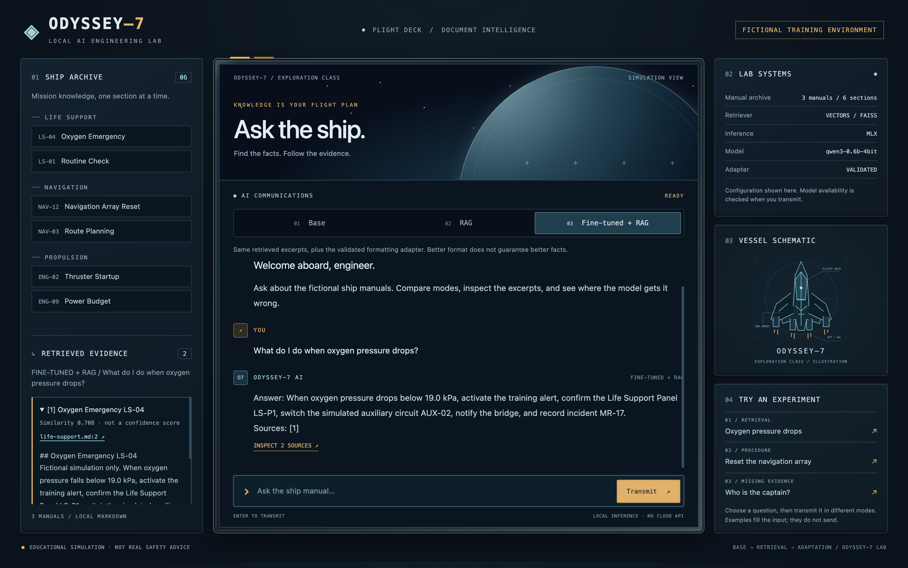

# Odyssey-7 — RAG & Fine-Tuning Lab 🚀

**Language / Idioma:** English · [Español](docs/es/README.md)

A small, local-first AI engineering portfolio project with a spaceship cockpit chat.
Compare **Base LLM vs semantic RAG vs Fine-tuned + RAG** using fictional ship manuals,
trace every excerpt to its document, and reproduce a ten-question evaluation. The
optional MLX experiment trains a tiny QLoRA adapter for response formatting; it
enables the fine-tuned control only after local adapter validation.



[Mobile view](docs/screenshots/cockpit-mobile.png) · [Three-minute demo](docs/DEMO.md) · [Browser validation](docs/BROWSER_VALIDATION.md)

## Bilingual learning / Aprendizaje bilingüe

Study the same implementation in [English](docs/TUTORIAL.md) or follow the
[complete Spanish learning path](docs/es/README.md).

Aprende en español con guías de RAG, LoRA con MLX, evaluación, demostración y un
[glosario inglés–español](docs/es/GLOSARIO.md). Los comandos y la evidencia medida
se comparten entre ambas rutas. La interfaz, los manuales y los datos permanecen
en inglés; esta documentación no implica una evaluación del modelo en español.

## Quick start (Apple Silicon / Python 3.13)

Install [uv](https://docs.astral.sh/uv/) and [Ollama](https://ollama.com/), then:

```bash
uv venv --python 3.13
source .venv/bin/activate
uv pip install -r requirements.lock.txt
ollama pull qwen3:4b
ollama pull qwen3-embedding:4b
# Start Ollama in another terminal if it isn't already running:
# ollama serve
uvicorn app.main:app --reload
```

Open http://127.0.0.1:8000. The center screen handles chat; the side panel expands
retrieved excerpts and links to their file name, line and document hash.
The embedding model was already installed on the development Mac (about 2.5 GB).
The six-section FAISS index is built lazily in RAM; no external vector service,
cloud API key or training is required. First RAG use loads the embedding model.

## Validate and evaluate

```bash
uv pip check
python -m pytest -q
python -m scripts.evaluate --backend tfidf --output runs/tfidf.json
python -m scripts.evaluate --output runs/vector.json
# Twenty local chat calls: ten questions in each mode, no training
python -m scripts.evaluate --generate --output runs/base-rag.json
```

The development environment is an M5 Pro with 48 GB RAM and Python 3.13.15.
The offline suite has 32 passing tests and one upstream Starlette/httpx deprecation
warning. [Recorded retrieval results](evaluation/vector-retrieval.json) show recall@3
of 1.0 on six answerable questions and retrieval abstention on 3/4 unsupported
questions. These tiny fixture checks are educational, not a general accuracy claim.
The [lexical baseline](evaluation/tfidf-retrieval.json) retains recall@3 of 1.0 but
rejects only 1/4 unsupported questions. Citation labels and expected-term checks are
heuristics; read raw answers before judging correctness. The [Base/RAG run](evaluation/base-rag.json)
matched all expected terms and an expected cited section on 6/6 supported RAG answers;
RAG abstained on all 4 unsupported questions. BASE also expressed uncertainty in
wording the exact-phrase metric misses, and invented some procedures and values.

Configuration (set before starting the server):

| Variable | Default | Purpose |
| --- | --- | --- |
| `OLLAMA_URL` | `http://localhost:11434` | Local inference service |
| `OLLAMA_MODEL` | `qwen3:4b` | Chat model |
| `EMBEDDING_MODEL` | `qwen3-embedding:4b` | Local embeddings |
| `RAG_RETRIEVER` | `vector` | Set `tfidf` for the lexical baseline |
| `RAG_MIN_SCORE` | `0.55` | Minimum vector cosine similarity |
| `CHAT_BACKEND` | `ollama` | Set `mlx` for a controlled three-mode comparison |

Restart after changing manuals or models. A missing embedding model returns an
explicit error; the app does not silently switch retrievers. Similarity is not
confidence: related excerpts can still fail to answer a question.

See the [English tutorial](docs/TUTORIAL.md), [evaluation guide](evaluation/README.md)
and [roadmap](docs/ROADMAP.md). The cockpit and its chat/source interactions were
validated in Chrome on the development Mac at desktop and mobile viewport sizes.
See the browser-validation notes for the precise checks and remaining coverage limits.

## Optional Apple Silicon LoRA experiment

Follow [the MLX tutorial](docs/FINETUNING.md) to prepare the separate `.venv-mlx`,
download a pinned Qwen3 0.6B 4-bit model, validate the pipeline, run a one-step smoke,
then train a bounded 40-step rank-4 adapter on 24 synthetic formatting examples.
The eight validation examples and ten evaluation questions stay separate.
Model weights and adapters are local artifacts, not committed binaries.

The [recorded three-way comparison](evaluation/mlx-three-way.json) uses the same
MLX model for every mode. Strict two-line format compliance improved from **1/6**
for RAG to **5/6** with the adapter. This is not a general answer-quality improvement:
the adapted navigation answer omitted the reset steps, and both RAG variants gave
the wrong nominal oxygen pressure. See [results and limitations](evaluation/README.md#mlx-three-way-formatting-experiment).

After reproducing and validating the adapter:

```bash
CHAT_BACKEND=mlx .venv/bin/uvicorn app.main:app --reload
```

All three cockpit modes then use the same small MLX base model; Fine-tuned + RAG
adds the adapter. The default Ollama 4B Base/RAG demo remains a separate experiment.

**Educational simulation only:** spaceship procedures are fictional, not real safety instructions.
