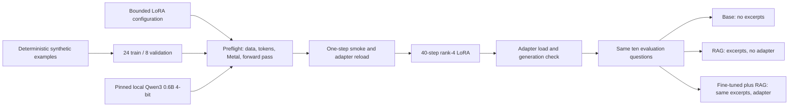

# A tiny MLX LoRA formatting experiment

## What this experiment tests

The goal is a consistent two-line answer format:

```text
Answer: Select SCAN-14.
Sources: [1]
```

RAG provides the facts. LoRA changes a small set of model parameters to practice
formatting and source-label use. The training examples describe invented training
beacons, not Odyssey-7's manuals. The ten evaluation questions stay out of training.
The same formatting instruction is supplied to the unadapted and adapted model;
otherwise the comparison would mix a prompt change with an adapter change.

The candidate model is [mlx-community/Qwen3-0.6B-4bit](https://huggingface.co/mlx-community/Qwen3-0.6B-4bit),
a roughly 335 MB MLX conversion of Qwen3 0.6B with an Apache-2.0 license. Download
revision and local path are recorded in `training/model.json`. This small model is
chosen to keep an educational experiment cheap, not to outperform the existing
Ollama 4B model. Because the base weights are 4-bit, this is quantized LoRA (QLoRA).
See the [MLX-LM LoRA guide](https://github.com/ml-explore/mlx-lm/blob/main/mlx_lm/LORA.md).



## 1. Keep optional dependencies separate

From the repository root, on Apple Silicon with Python 3.13:

```bash
uv venv .venv-mlx --python 3.13
uv pip install --python .venv-mlx/bin/python -r requirements-mlx.lock.txt
uv pip check --python .venv-mlx/bin/python
```

The app keeps using `.venv`. The optional environment contains MLX-LM and its
training dependencies, including the upstream dataset loader. No Hugging Face
training dataset is downloaded. Weights, environments, adapters and model caches
are ignored by Git; only small source, data and measured reports are tracked.
Do not enable remote model code or upload anything for this exercise.

## 2. Download the pinned small model and validate data

```bash
HF_HOME=.models/hf HF_HUB_DISABLE_XET=1 .venv-mlx/bin/python -m scripts.prepare_mlx_model
.venv/bin/python -m scripts.prepare_training
.venv/bin/python -m scripts.validate_training
```

The downloader uses `training/model.json` to select the exact model revision.
The generator deterministically writes 24 train and 8 validation chat examples.
Each example has system, user and assistant messages. Supported examples copy an
explicit command from a short synthetic excerpt; unsupported examples abstain.
Validation uses different beacon identifiers and commands. These are simple template
variations, not an independent measure of broad generalization.

The offline validator checks nonempty messages, format, duplicate questions across
splits, and exact overlap with evaluation questions. Inspect the generator too:
it never reads the manuals or evaluation answers. Exact overlap checking alone
cannot detect all possible semantic data leakage in a larger project.

## 3. Validate the pipeline before training

```bash
HF_HUB_OFFLINE=1 .venv-mlx/bin/python -m scripts.preflight_mlx
```

Preflight loads the local model with remote code disabled, verifies Metal access,
tokenizes every example through MLX-LM's actual masked-prompt chat dataset path,
checks that no example exceeds 384 tokens, executes a finite forward pass and runs
base generation. It writes `training/preflight.json` with package versions, model
revision, data/config hashes, token lengths and the observed smoke answer. It does
not update weights. On a normal local terminal Metal should be available; an agent
sandbox may need GPU access outside its sandbox for this command.

The checked configuration in `training/lora.yaml` limits this demonstration to:

| Setting | Value |
| --- | --- |
| Model | Qwen3 0.6B, 4-bit |
| Training / validation rows | 24 / 8 |
| Trainable transformer layers | Last 4 of 28 |
| LoRA rank / scale | 4 / 8 |
| Batch / sequence limit | 1 / 384 tokens |
| Learning rate | 0.0001 |
| Seed | 7 |
| Validation batches per checkpoint | 4 of the 8-example split |
| Full demonstration updates | 40 |

Prompt masking computes loss on the assistant completion, rather than teaching the
model to reproduce the question or manual excerpt. The base weights stay frozen.
The runner rejects changed data/config/model manifests until preflight is repeated.

## 4. Run one step, reload, then run the bounded experiment

```bash
HF_HUB_OFFLINE=1 .venv-mlx/bin/python -m scripts.train_mlx --smoke
# Only after the smoke run succeeds:
HF_HUB_OFFLINE=1 .venv-mlx/bin/python -m scripts.train_mlx
HF_HUB_OFFLINE=1 .venv-mlx/bin/python -m scripts.validate_adapter
```

The one-step run saves a separate adapter in `adapters/smoke`, reloads it and tests
generation. The 40-step run starts fresh from the same base and saves its adapter
in `adapters/odyssey-format`; it does not resume the smoke adapter. Both commands
use the official MLX-LM training CLI. Logs and reports are written under `training/`.
Validation loss uses four batches from the eight-example synthetic split per
checkpoint; it is not an answer-accuracy score. Training loss improvement alone does not establish better RAG answers.

`validate_adapter` loads the adapter against its configured base and generates an
answer from a validation example. Only then does it write `ready.json` with hashes.
The app requires that readiness record, unchanged adapter/config files, base weight size/modification stamps and the same
model configuration before it enables the fine-tuned control. Rerun validation after
moving the project or replacing an adapter. Never copy a readiness record to a
different model to bypass these checks.

## 5. Compare three modes with a controlled base model

With local Ollama running for embeddings:

```bash
CHAT_BACKEND=mlx .venv/bin/python -m scripts.evaluate --generate --include-finetuned --output runs/mlx-three-way.json
```

All three modes use the same local MLX model and tokenizer, seed 7, greedy sampling,
a 256-token output limit and thinking disabled. BASE sees no manual. RAG and
Fine-tuned + RAG receive identical retrieved excerpts and formatting instructions;
the runner asserts identical model messages. Similarity scores can differ slightly
between embedding calls, but are not part of the model prompt. Only the last mode loads the adapter.
Do not compare these scores directly to the earlier Ollama Qwen3 4B report to infer
an adapter improvement: model size, runtime, prompts and sampling differ.

The report includes strict two-line format compliance on the six answerable
questions, expected-term coverage, citation-label checks and abstention. A compliant
format can contain a wrong answer. Expected terms can appear in an otherwise wrong
answer. An in-range citation can still support the wrong claim. Read the raw answers.
Three unsupported questions may be rejected before generation by the retriever;
that behavior belongs to the application, not to learned adapter abstention.

## 6. Use the validated adapter in the cockpit

```bash
CHAT_BACKEND=mlx .venv/bin/uvicorn app.main:app --reload
```

The server stays in the light app environment and invokes a bounded local MLX worker
in `.venv-mlx` for each generated answer. It loads the small model per request; this
adds overhead but avoids a second persistent inference service. Inference is local
and offline, has a timeout, and cleans up the child process. The UI reports its
backend and model; fine-tuned mode remains unavailable unless readiness checks pass.
Set `MLX_MODEL_PATH`, `MLX_ADAPTER_PATH`, or `MLX_PYTHON` before startup to override
the default project paths. All three modes use MLX when `CHAT_BACKEND=mlx`.
Without that variable, the original Ollama Base/RAG demonstration remains available.

## Recorded outcome on the development Mac

Preflight, the one-step smoke, the bounded 40-step run, adapter reload and live HTTP
inference all passed on the M5 Pro / 48 GB. The actual token lengths were 122–127,
below the 384-token limit. MLX-LM reported 0.360M trainable parameters, or 0.060% of
the base. The approximately 1.4 MB adapter remains local and can be reproduced with
the pinned model, dependency snapshot, data, configuration and seed above.

Strict format compliance rose from 1/6 to 5/6 supported answers in the controlled
MLX comparison. This is a narrow result: both RAG modes answered nominal pressure
incorrectly, and the adapter shortened the navigation answer enough to lose its
reset sequence. Full raw outputs, a comparison table and metric caveats are in
[evaluation/README.md](../evaluation/README.md#mlx-three-way-formatting-experiment).

Tracked evidence: `training/preflight.json`, `training/smoke.json`,
`training/training.json`, `training/training.log`, `training/adapter-validation.json`
and `training/http-smoke.json`. The readiness file is machine-local and regenerated;
a clone does not acquire a working adapter merely by having these tracked reports.
Subsequent cockpit browser checks are recorded in [BROWSER_VALIDATION.md](BROWSER_VALIDATION.md);
the HTTP smoke record above remains the evidence for the original Phase 3 API run.
