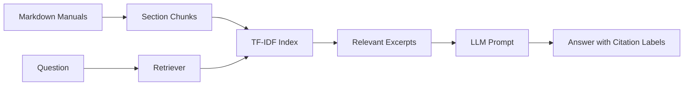
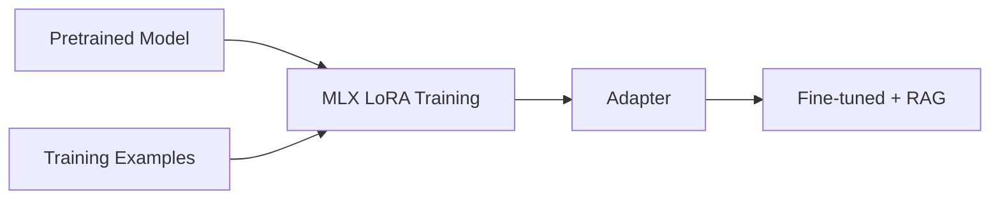

# Educational tutorial — why, how, and what to measure

## RAG
RAG retrieves relevant documents at answer time, without changing model weights. Our first version uses TF-IDF (lexical similarity), not embeddings. The next phase introduces true vector retrieval.



## Fine-tuning
LoRA trains a small adapter to influence response behavior or formatting. It does not replace RAG for current facts. This is planned, not implemented.



## First experiment
1. Ask `What do I do when oxygen pressure drops?` in BASE mode.
2. Ask again in RAG mode.
3. Compare the responses and inspect retrieved sections.
4. Ask `Who is the captain?` and check whether the assistant admits insufficient evidence.
5. Record outputs for a future evaluation set.

## Current limitations
The starter does not include semantic embeddings, vector storage, LoRA training, or formal evaluation metrics. Citations are prompted and retrieved section names are displayed, but citation correctness has not yet been evaluated. Ship procedures are fictional.

## Phase 1: reproduce the local integration check

Use Python 3.13 on Apple Silicon. `requirements.txt` names the direct dependencies;
`requirements.lock.txt` captures the full environment validated on the development Mac.

```bash
uv venv --python 3.13
source .venv/bin/activate
uv pip install -r requirements.lock.txt
uv pip check
python -m pytest -q
ollama list
# If qwen3:4b is missing:
ollama pull qwen3:4b
# In a separate terminal, if Ollama is not already running:
ollama serve
# Start the web application:
uvicorn app.main:app --host 127.0.0.1 --port 8000
```

Visit http://127.0.0.1:8000. The center display is the chat interface.
Ask the oxygen question in BASE and RAG, then ask who the captain is.
During inference, controls are disabled to keep one request and its source panel together.
The fine-tuned control stays disabled. Whitespace-only questions are rejected, and
unreachable or malformed Ollama responses produce HTTP 503 with setup guidance.

You can check the same HTTP integration without a browser:

```bash
curl --fail http://127.0.0.1:8000/api/docs
curl --fail http://127.0.0.1:8000/api/ask \
  -H 'Content-Type: application/json' \
  -d '{"mode":"rag","question":"What do I do when oxygen pressure drops?"}'
```

`OLLAMA_URL` overrides the default `http://localhost:11434`; `OLLAMA_MODEL`
overrides `qwen3:4b`. Restart the server after changing these variables.
The request disables Qwen thinking output for a concise cockpit response and uses
90 seconds as the inference timeout. A cold model load can require a retry.

The offline tests exercise static routes, input validation, the two prompt paths,
retrieved section traceability, and model failure handling with a mocked Ollama.
They do not measure model accuracy. The separate recorded local smoke run uses real
Ollama responses; it is not an evaluation benchmark. Citation labels are generated
by the model and are not yet checked automatically.

### Observed smoke result (2026-10-20)

On the updated server at port 8001, the oxygen RAG response included LS-P1,
AUX-02 and MR-17 with citation [1] to the retrieved oxygen section. The captain
question returned the deterministic no-evidence response. BASE acknowledged missing
manual access but also generated unsupported general guidance and fictional-source
claims. These raw outputs are preserved in `phase1-smoke.json`; they demonstrate
integration and model limitations, not reliable real-world guidance or measured
accuracy. The first exploratory run used an older process on port 8000; the saved
record was replaced with the updated server's results.

Zero-match abstention does not solve questions that retrieve irrelevant overlapping
words. That failure mode, citation checking and a fixed evaluation set belong to
Phase 2. Browser rendering and responsive interaction still require manual validation.
