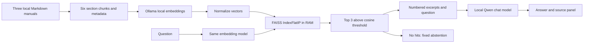
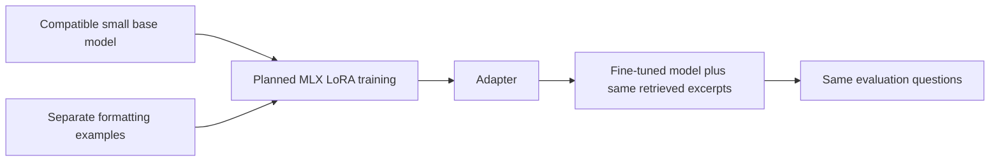

# Odyssey-7 tutorial: local document Q&A

## 1. Start with the smallest useful system

The corpus contains three Markdown manuals with two sections each. Each `##`
heading starts one chunk; document titles are not separate evidence. The loader
keeps the section title and body together. Every chunk has a stable ID derived
from its file and heading, the starting line, a SHA256 of its full document, and
a URL that returns the exact loaded excerpt. A restart reloads modified manuals.
This makes the mapping from a retrieved chunk to its original document inspectable.



Embeddings encode semantic similarity. FAISS searches normalized float32 vectors
with inner product, equivalent to cosine similarity. For six chunks, exact search
is simpler than approximate search; no index training or database daemon is needed.
The index lives only in RAM and is rebuilt on server restart or an embedding-model
configuration change. Queries are embedded on demand. Source files stay local.

The prior TF-IDF implementation remains available with `RAG_RETRIEVER=tfidf`.
It matches words and word pairs rather than learned semantic representations.
Neither method can determine whether a passage logically answers a question.

Implementation references: [Ollama embed API](https://docs.ollama.com/api/embed),
[FAISS getting started](https://github.com/facebookresearch/faiss/wiki/Getting-started).

## 2. Reproduce the environment

Install Python 3.13, uv and Ollama on Apple Silicon:

```bash
uv venv --python 3.13
source .venv/bin/activate
uv pip install -r requirements.lock.txt
uv pip check
python -m pytest -q
ollama pull qwen3:4b
ollama pull qwen3-embedding:4b
# Only if the Ollama service is not already running, in another terminal:
ollama serve
```

`requirements.txt` lists direct dependencies; `requirements.lock.txt` captures all
versions installed for this Mac validation. The embedding model is not a training
model; it only generates vectors. Its approximately 2.5 GB download is separate
from the Python environment. You can choose a different local embedding model with
`EMBEDDING_MODEL`, but must rerun evaluation and reconsider the similarity threshold.

```bash
uvicorn app.main:app --reload
```

Open http://127.0.0.1:8000. If another process already owns port 8000, use
`uvicorn app.main:app --port 8001` and visit that port. Stop that server with Ctrl+C.
Set `OLLAMA_URL` and `OLLAMA_MODEL` if using nondefault local settings.
An unavailable chat/embedding service returns HTTP 503 with setup guidance.
There is no automatic model download or cloud fallback. The initial embedding call
allows 120 seconds and chat allows 90 seconds; cold loading can require a retry.

## 3. Inspect an answer

1. Ask `What do I do when oxygen pressure drops?` in BASE.
2. Switch to RAG and repeat the exact question.
3. Expand `[1] Oxygen Emergency LS-04` in the source panel. Follow the source link
   to see the loaded excerpt, original line and document hash.
4. Ask `Who is the captain?`. With no vector above the threshold, the app returns
   `Not found in the provided manual.` without invoking the chat model.
5. Ask `How often must the CO2 scrubber be replaced?`. A related routine-check
   excerpt may be retrieved even though no replacement interval is documented.
   The model must recognize that gap. This is a harder abstention case.

The numeric labels correspond to the source list for that answer, not global file
numbers. Source details are populated with text nodes so manual content is displayed
as text. Chat controls are disabled during each request to keep answers and sources
in order. Unsupported fine-tuned mode remains disabled and the API rejects it.

## 4. Measure before changing the pipeline

```bash
python -m scripts.evaluate --backend tfidf --output runs/tfidf.json
python -m scripts.evaluate --output runs/vector.json
python -m scripts.evaluate --generate --output runs/base-rag.json
```

See [evaluation/README.md](../evaluation/README.md) for metric definitions, the fixed
ten-question dataset, raw reports and limitations. Retrieval-only runs do not call
the chat model. `--generate` runs identical questions through both modes. The runner
fails if inference fails; it does not substitute fabricated results.

`RAG_MIN_SCORE=0.55` is the initial vector threshold, not a calibrated probability.
For an exploratory threshold run:

```bash
python -m scripts.evaluate --threshold 0.6 --output runs/vector-060.json
```

Do not tune on these ten questions and then describe the result as held-out accuracy.
Future changes should add separate development/test questions. A retrieved section
and an in-range citation do not prove that every claim in the answer is supported.

## 5. Understand the future LoRA experiment

RAG supplies facts at answer time without changing weights. LoRA trains a small
adapter to influence response style or format. The next phase will validate MLX-LM
and a small compatible model, prepare separate train/validation examples for
consistent formatting, and run a tiny pipeline check before any training experiment.
The evaluation questions must not become training examples.



No adapter, training result or fine-tuned inference path exists yet. An adapter
should not be used to memorize the manuals. Any later three-way comparison must
report model identities and account for differences between Ollama and MLX runtimes.

## Validation boundaries

The Phase 1 [HTTP smoke record](phase1-smoke.json) predates semantic retrieval.
It captures real local responses, including unsupported claims made by BASE; it is
not a current benchmark. Phase 2 reports use the new prompts and section loader.
The tests cover API paths, prompt isolation, document traceability, vector ranking,
cache reuse, embedding failures and evaluation scoring. Browser automation was
unavailable, so responsive visual checks remain pending. All ship procedures are
fictional and unsuitable for real-world safety use.
