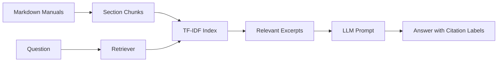
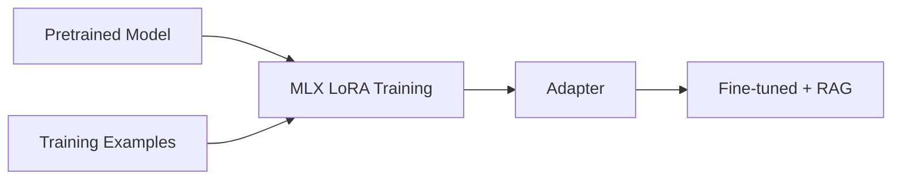

# Educational tutorial — why, how, and what to measure

## RAG
RAG retrieves relevant documents at answer time, without changing model weights. Our first version uses TF-IDF (lexical similarity), not embeddings. The next phase introduces true vector retrieval.

## Fine-tuning
LoRA trains a small adapter to influence response behavior or formatting. It does not replace RAG for current facts. This is planned, not implemented.

## First experiment
1. Ask `What do I do when oxygen pressure drops?` in BASE mode.
2. Ask again in RAG mode.
3. Compare the responses and inspect retrieved sections.
4. Ask `Who is the captain?` and check whether the assistant admits insufficient evidence.
5. Record outputs for a future evaluation set.

## Current limitations
The starter does not include semantic embeddings, vector storage, LoRA training, or formal evaluation metrics. Citations are prompted and retrieved section names are displayed, but citation correctness has not yet been evaluated. Ship procedures are fictional.
