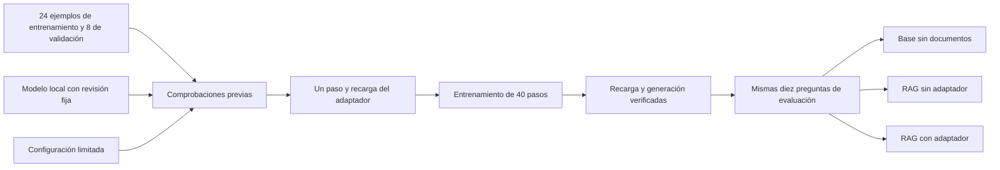

# Un experimento pequeño de LoRA con MLX

**Idioma / Language:** Español · [English](../FINETUNING.md) · [Índice en español](README.md)

## 1. Define qué quieres enseñar al modelo

El objetivo es practicar un formato de dos líneas, conservado en inglés porque
es el formato que usa el entrenamiento y que comprueba el evaluador:

```text
Answer: Select SCAN-14.
Sources: [1]
```

RAG aporta los hechos mediante documentos. LoRA entrena un conjunto pequeño de
parámetros adicionales para influir en el comportamiento. Los ejemplos de este
experimento describen balizas de entrenamiento inventadas: no contienen los hechos
de los manuales de Odyssey-7 ni las diez preguntas de evaluación.

Tanto el modelo sin adaptador como el adaptado reciben la misma instrucción de
formato. Si solo la recibiera el segundo, estaríamos mezclando el efecto de cambiar
el prompt con el de entrenar el adaptador.

Se usa [mlx-community/Qwen3-0.6B-4bit](https://huggingface.co/mlx-community/Qwen3-0.6B-4bit),
una conversión a MLX de unos 335 MB, con licencia Apache-2.0. La revisión exacta y
la ruta local están en [training/model.json](../../training/model.json).
Como la base está cuantizada a 4 bits, el experimento es QLoRA: LoRA sobre una base
cuantizada. El modelo pequeño mantiene bajo el costo de la demostración; no se
eligió para superar al modelo de 4B usado con Ollama.



## 2. Separa las dependencias opcionales

En Apple Silicon, desde la raíz del repositorio:

```bash
uv venv .venv-mlx --python 3.13
uv pip install --python .venv-mlx/bin/python -r requirements-mlx.lock.txt
uv pip check --python .venv-mlx/bin/python
```

La aplicación sigue usando `.venv`; entrenamiento e inferencia MLX usan `.venv-mlx`.
Esto mantiene las dependencias de GPU fuera del entorno principal. No se descarga
un conjunto de entrenamiento de Hugging Face. Git ignora entornos, cachés, pesos y
adaptadores; conserva los datos pequeños, la configuración y la evidencia medida.

## 3. Prepara el modelo y los datos

```bash
HF_HOME=.models/hf HF_HUB_DISABLE_XET=1 .venv-mlx/bin/python -m scripts.prepare_mlx_model
.venv/bin/python -m scripts.prepare_training
.venv/bin/python -m scripts.validate_training
```

El descargador usa la revisión fijada en `training/model.json`. El generador escribe
de manera determinista 24 ejemplos de entrenamiento y 8 de validación. Cada ejemplo
contiene mensajes `system`, `user` y `assistant`. En los casos respaldados, la
respuesta copia una orden del extracto sintético; en los no respaldados, se abstiene.
La validación usa otros identificadores de baliza y órdenes.

Son variaciones de plantillas sencillas. Un buen resultado sobre ellas no demuestra
que el comportamiento se generalice a documentos o preguntas complejas. El validador
comprueba formato, mensajes vacíos, duplicados entre particiones y coincidencias
exactas con las preguntas de evaluación. Esa última comprobación no detectaría por
sí sola toda posible fuga semántica de datos en un proyecto mayor.

## 4. Valida antes de entrenar

```bash
HF_HUB_OFFLINE=1 .venv-mlx/bin/python -m scripts.preflight_mlx
```

Esta comprobación previa carga el modelo local con código remoto deshabilitado,
verifica acceso a Metal, tokeniza todos los ejemplos usando la ruta real de datos
con enmascaramiento del prompt, ejecuta un paso de propagación hacia delante con
valores finitos y genera una respuesta de prueba. No actualiza pesos.

`training/preflight.json` registra versiones, revisión del modelo, hashes de datos
y configuración, longitudes y la respuesta observada. En el Mac validado, los
ejemplos ocuparon entre 122 y 127 tokens, por debajo del límite de 384. Una sesión
restringida puede no tener acceso a la GPU aunque el Mac disponga de ella.

La configuración [training/lora.yaml](../../training/lora.yaml) limita el ejercicio:

| Parámetro | Valor |
| --- | --- |
| Modelo | Qwen3 0.6B, 4 bits |
| Ejemplos de entrenamiento / validación | 24 / 8 |
| Capas adaptadas | Últimas 4 de 28 |
| Rango / escala LoRA | 4 / 8 |
| Tamaño de lote | 1 |
| Longitud máxima | 384 tokens |
| Tasa de aprendizaje | 0.0001 |
| Semilla | 7 |
| Lotes de validación por punto de control | 4 del conjunto de 8 ejemplos |
| Actualizaciones del experimento | 40 |

El enmascaramiento del prompt calcula la pérdida sobre la respuesta del asistente,
no sobre la reproducción de la pregunta o del extracto. Los pesos de la base
permanecen congelados. Si cambian datos, configuración o manifiesto del modelo,
el ejecutor exige repetir la validación previa.

## 5. Prueba un paso y luego ejecuta el experimento limitado

```bash
HF_HUB_OFFLINE=1 .venv-mlx/bin/python -m scripts.train_mlx --smoke
# Continúa únicamente cuando la prueba de un paso haya terminado correctamente:
HF_HUB_OFFLINE=1 .venv-mlx/bin/python -m scripts.train_mlx
HF_HUB_OFFLINE=1 .venv-mlx/bin/python -m scripts.validate_adapter
```

La primera ejecución guarda un adaptador en `adapters/smoke`, lo vuelve a cargar
y comprueba generación. La de 40 pasos empieza de nuevo desde la base: no continúa
el adaptador de prueba. Guarda el resultado en `adapters/odyssey-format`.
Ambas usan la herramienta oficial de entrenamiento de MLX-LM.

La pérdida de validación se calcula con cuatro lotes de la partición sintética de
ocho ejemplos por punto de control. Su reducción no demuestra mayor exactitud en
preguntas sobre documentos. La validación del adaptador comprueba una generación
real y solo después escribe `ready.json` con la identidad y los hashes requeridos.

La aplicación exige ese registro, el mismo modelo configurado y archivos del
adaptador sin cambios. También comprueba tamaño y fecha de modificación de los
pesos de la base. Si mueves el proyecto o reemplazas el adaptador, repite la
validación. Los informes guardados en Git no sustituyen los pesos ni un registro
de disponibilidad válido en tu máquina.

## 6. Compara con una base controlada

Mantén Ollama activo para generar embeddings:

```bash
CHAT_BACKEND=mlx .venv/bin/python -m scripts.evaluate --generate --include-finetuned --output runs/mlx-three-way.json
```

Los tres modos usan el mismo modelo y tokenizador MLX, semilla 7, selección voraz,
un límite de 256 tokens de salida y el razonamiento explícito deshabilitado.
Base no recibe manuales. RAG y Fine-tuned + RAG reciben mensajes idénticos; solo el
último carga el adaptador. Los puntajes de similitud pueden variar ligeramente
entre llamadas, pero no forman parte del prompt. El evaluador comprueba la igualdad
de los mensajes reales que reciben ambos modelos.

No atribuyas al adaptador las diferencias frente al informe anterior de Ollama 4B:
cambian modelo, tamaño, motor de inferencia, prompts y muestreo. La comparación
válida del adaptador es entre los dos modos RAG de esta ejecución MLX.

## 7. Usa el adaptador validado en la cabina

```bash
CHAT_BACKEND=mlx .venv/bin/uvicorn app.main:app --reload
```

La aplicación inicia un proceso MLX local y acotado para cada respuesta generada.
Carga el modelo pequeño por solicitud: añade tiempo, pero evita mantener otro
servidor de inferencia. La inferencia MLX es local, se ejecuta sin descargas y tiene
un tiempo máximo de espera. El proceso hijo se limpia al terminar o agotarse ese tiempo.

Puedes definir `MLX_MODEL_PATH`, `MLX_ADAPTER_PATH` y `MLX_PYTHON` antes de iniciar
para cambiar las rutas predeterminadas. Si omites `CHAT_BACKEND=mlx`, permanece
la demostración Base/RAG de Ollama. La interfaz sigue en inglés.

## 8. Interpreta el resultado registrado

Se verificaron carga, propagación, entrenamiento, recarga e inferencia HTTP en el
M5 Pro de 48 GB. MLX-LM informó unos 0.360 millones de parámetros entrenables,
el 0.060% de la base. El adaptador local ocupa aproximadamente 1.4 MB.

El cumplimiento estricto del formato pasó de **1/6 a 5/6** respuestas respaldadas.
Sin embargo, ambos modos RAG respondieron mal la presión nominal de oxígeno y la
respuesta adaptada de navegación omitió la secuencia de reinicio. Lee la
[evaluación en español](EVALUACION.md) y las respuestas originales antes de concluir
que un ajuste es beneficioso.

Evidencia compartida con la documentación en inglés:
[preflight](../../training/preflight.json), [prueba de un paso](../../training/smoke.json),
[registro de entrenamiento](../../training/training.log),
[validación del adaptador](../../training/adapter-validation.json) y
[prueba HTTP](../../training/http-smoke.json).
La referencia técnica es la [guía oficial de LoRA de MLX-LM](https://github.com/ml-explore/mlx-lm/blob/main/mlx_lm/LORA.md).
Esta documentación no ejecuta de nuevo el entrenamiento ni modifica sus resultados.
