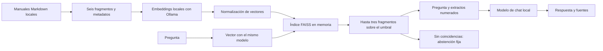

# Tutorial: preguntas sobre documentos con RAG local

**Idioma / Language:** Español · [English](../TUTORIAL.md) · [Índice en español](README.md)

## 1. Distingue los tres modos

| Modo de la interfaz | Qué información recibe | Qué cambia |
| --- | --- | --- |
| Base | Pregunta e instrucciones, sin manuales | Punto de comparación sin recuperación |
| RAG | Pregunta, instrucciones y fragmentos recuperados | Contexto disponible al responder |
| Fine-tuned + RAG | El mismo contexto RAG y las mismas instrucciones | Un adaptador entrenado para practicar el formato |

RAG significa *Retrieval-Augmented Generation*: generación aumentada por
recuperación. Busca información antes de generar la respuesta; no modifica los
pesos del modelo. LoRA, en cambio, entrena un adaptador pequeño. En este proyecto
el adaptador practica el formato, no memoriza los manuales.

La comparación controlada de los tres modos utiliza el mismo modelo MLX de 0.6B.
La demostración predeterminada de Ollama usa otro modelo, Qwen3 4B: sus resultados
son un experimento separado.

## 2. Convierte los manuales en fragmentos trazables

El corpus tiene tres archivos Markdown con dos secciones cada uno. Cada encabezado
`##` inicia un fragmento que conserva el título de la sección y su contenido.
El título general del documento no se indexa como evidencia independiente.

Cada fragmento incluye un identificador estable derivado del archivo y del
encabezado, el nombre del archivo, la línea inicial, el SHA256 del documento completo
y una URL que devuelve el texto cargado. Así puedes comprobar de dónde salió la
información. El hash identifica la versión del contenido; no demuestra que ese
contenido sea verdadero. Reiniciar la aplicación vuelve a cargar los manuales.



## 3. Entiende la recuperación vectorial

Un *embedding* es una representación numérica del texto. Aquí, Ollama genera
vectores para los fragmentos y para la pregunta. Se normalizan y se almacenan como
valores `float32` en un índice FAISS `IndexFlatIP`.

El producto interno de vectores normalizados equivale a la similitud coseno.
FAISS busca de forma exacta: con seis fragmentos no hace falta una búsqueda
aproximada ni entrenar un índice. El índice vive en RAM, se construye al necesitarlo
y se reconstruye al reiniciar o al cambiar la configuración del modelo de embeddings.
Las preguntas se convierten en vectores cuando llegan.

El sistema devuelve hasta tres coincidencias que alcancen el umbral inicial de
`0.55`. Este umbral es una decisión de la demostración, no una probabilidad calibrada.
Si no hay coincidencias, devuelve `Not found in the provided manual.` sin llamar al
modelo de chat. Esa abstención es una regla de la aplicación.

La alternativa `RAG_RETRIEVER=tfidf` conserva la referencia léxica: compara palabras
y pares de palabras. La búsqueda vectorial puede relacionar expresiones con distinto
vocabulario, pero ninguno de los dos métodos demuestra que un fragmento responda
lógicamente a la pregunta. En el conjunto pequeño ambos obtuvieron recall@3 de 1.0;
no se midió una mejora de recall por usar vectores.

## 4. Prepara el entorno

Desde la raíz del repositorio:

```bash
uv venv --python 3.13
source .venv/bin/activate
uv pip install -r requirements.lock.txt
uv pip check
python -m pytest -q
ollama pull qwen3:4b
ollama pull qwen3-embedding:4b
# En otra terminal, solo si el servicio no está activo:
ollama serve
```

Después inicia la aplicación:

```bash
uvicorn app.main:app --reload
```

Abre http://127.0.0.1:8000. `requirements.txt` enumera dependencias directas;
`requirements.lock.txt` conserva las versiones del entorno validado. Los modelos
se descargan por separado. Si cambias `EMBEDDING_MODEL`, repite la evaluación y
reconsidera el umbral: los resultados de un modelo no validan otro.

Si el servicio de embeddings o de chat falla, la API devuelve HTTP 503 con una
indicación de configuración. La llamada a embeddings permite 120 segundos; el chat
de Ollama, 90 segundos. Una carga inicial lenta puede requerir otro intento.

## 5. Inspecciona una respuesta en la cabina

Los ejemplos se mantienen en inglés para reproducir las mediciones existentes:

| Pregunta reproducible | Significado en español |
| --- | --- |
| `What do I do when oxygen pressure drops?` | ¿Qué hago cuando baja la presión de oxígeno? |
| `Who is the captain?` | ¿Quién es el capitán? |
| `How often must the CO2 scrubber be replaced?` | ¿Cada cuánto se debe reemplazar el depurador de CO2? |

1. Pregunta por el oxígeno en Base y luego repite exactamente la pregunta en RAG.
2. Expande `[1] Oxygen Emergency LS-04` y compara cada acción con el extracto.
3. Sigue el enlace para ver archivo, línea, hash y texto original cargado.
4. Pregunta por el capitán. En la configuración evaluada no hay un fragmento sobre
   el umbral, así que la aplicación se abstiene sin generar una respuesta.
5. Pregunta por el intervalo de reemplazo del depurador. Puede recuperarse una
   sección relacionada, aunque no indique ningún intervalo. El modelo debe
   reconocer que falta el dato: es una prueba más difícil.

Las traducciones de la tabla son explicativas; no constituyen una evaluación en
español. Las etiquetas `[1]`, `[2]` corresponden a las fuentes de esa respuesta,
no a una numeración global de archivos. **Inspect evidence** restaura las fuentes
de una respuesta anterior después de otras consultas.

La interfaz usa texto literal para presentar las respuestas y los extractos.
Los controles se bloquean durante una solicitud y vuelven a estar disponibles al
terminar o fallar. Las conversaciones se guardan solo en memoria y desaparecen al
recargar. En pantallas estrechas, el chat aparece primero y el archivo debajo.
Los indicadores de configuración no son comprobaciones de salud del servicio.

## 6. Mide antes de modificar

```bash
python -m scripts.evaluate --backend tfidf --output runs/tfidf.json
python -m scripts.evaluate --output runs/vector.json
python -m scripts.evaluate --generate --output runs/base-rag.json
# Exploración de otro umbral, sin cambiar la configuración predeterminada:
python -m scripts.evaluate --threshold 0.6 --output runs/vector-060.json
```

Sin `--generate`, el evaluador mide recuperación y no llama al modelo de chat.
Con esa opción usa las mismas preguntas en Base y RAG. Si falla la inferencia,
el proceso falla en lugar de inventar resultados.

Lee la [guía de evaluación](EVALUACION.md) antes de interpretar las cifras. No
ajustes el sistema usando estas diez preguntas y luego presentes su resultado
como precisión en preguntas independientes. Una sección recuperada y una etiqueta
de cita válida no prueban que todas las afirmaciones estén respaldadas.

## 7. Continúa con LoRA

La [guía de MLX](FINETUNING.md) reproduce la validación previa, la prueba de un paso,
el entrenamiento limitado a 40 pasos y la comparación con el mismo modelo base.
En el experimento registrado mejoró el formato, pero persistieron errores de hechos
y se perdieron pasos de navegación. Consulta los [resultados y sus límites](EVALUACION.md).

Referencias de implementación: [API de embeddings de Ollama](https://docs.ollama.com/api/embed)
y [guía de FAISS](https://github.com/facebookresearch/faiss/wiki/Getting-started).
Son enlaces de la documentación original; esta traducción no implica una nueva
validación de versiones ni una ejecución adicional de los experimentos.

**Solo simulación educativa:** no uses los procedimientos ficticios como instrucciones reales.
